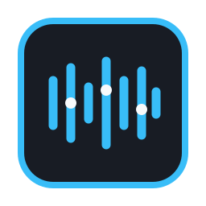

<p align="center">
  
</p>

<h1 align="center">AgentDAW</h1>

<p align="center">
  <strong>给 AI 用的离线多轨 DAW 引擎 &amp; Antigravity 插件，直接驱动本机康泰克 8（Kontakt 8）与真实采样音源库。</strong><br/>
  <strong>An AI-native offline multi-track DAW engine &amp; Antigravity plugin that drives local Kontakt 8 and real sample libraries directly via MCP.</strong>
</p>

<p align="center">
  <a href="#中文说明">中文说明</a> · <a href="#english">English</a>
</p>

---

## 🎬 宣传短片 / Promo Video

<video src="https://github.com/Eqarx/AgentDAW/releases/download/v1.0.0/AgentDAW_Promo.mp4" controls width="100%"></video>

> 宣传短片由 **Gemini 4 Neon** 仅通过一轮对话制作。  
> Promo video created by **Gemini 4 Neon** in a single conversation turn.  
> 如浏览器未直接内联播放，可直接观看或下载：[AgentDAW_Promo.mp4 (Release v1.0.0)](https://github.com/Eqarx/AgentDAW/releases/download/v1.0.0/AgentDAW_Promo.mp4)

---

<a id="中文说明"></a>
## 中文说明

### 这是什么？

我一直想让 AI 像人用 Reaper 一样，真正自己去选音色、写 MIDI、调混音、加效果器、甚至自己听完之后再改——而不是只能吐一段干巴巴的合成器 beep 音，或者把乐谱丢给人手动导入 DAW。

**AgentDAW** 就是为此做的：它是一个面向 Windows x64 的离线多轨音频工作站引擎，打包成原生的 **Antigravity 插件**（同时也提供标准 stdio MCP 服务和命令行工具）。

一个刻意坚持的原则：**里边不内置任何曲风模板、作曲套路或混音风格预设**，只提供干净的 DAW 工具接口，把所有音乐判断完全留给模型自己。

### 能做什么

- **直接驱动本机康泰克 8（Kontakt 8 VST3）**：支持搜索和加载本机 `.nki` 单乐器、`.nkm` 多乐器机架以及 `.vstpreset`。首次加载 `.nki`/`.nkm` 时会通过内置的 Windows OLE 桥接（`native/drop.dll`）自动完成载入并缓存预设，之后全程无头渲染。
- **完整多轨 MIDI 与演奏技法**：支持多轨音符、CC（0–127）、弯音（`pitch_bend`）、通道触后、Program Change、阶跃/线性速度图（`tempo_changes`）、Keyswitch 键位切换，以及标准 `.mid` 的导入与导出。
- **音频剪辑与 DSP 处理**：支持音频片段拼接、裁剪、淡入淡出（线性 / 等功率）、倒放、保音高变速（`speed`）与保时值变调（`pitch_semitones`）。
- **混音台、发送总线与 22+ 音效**：支持轨道 Mute/Solo、发送/返回总线（推子前/推子后）、逐采样音量/声像包络自动化、22 种内置 Pedalboard 效果器（参数 EQ、高/低通、梯形滤波、压缩、砖墙限制、门限、混响、延迟、IR 卷积、合唱、移相、失真、变调等）以及任意第三方 **VST3 效果器插件**，自动做延迟补偿冲刷。
- **增量工程编辑**：通过 `edit_project` 可以只换某个轨的音色、移调、量化、调力度、增删局部小节，不必每次重写整份乐谱 JSON。
- **让多模态模型自己“听”并迭代修改**：内置 `audition_project` 和 `audition_audio`，可渲染全曲、局部区间或单轨独奏，生成轻量 MP3/WAV 试听文件并附带 6 频段频谱、立体声相位相关性、左右平衡、波峰因数、削波计数等客观声学指标，让 Gemini 这类原生支持音频输入的模型自己听完再动手改。

### 快速安装（Windows x64 + Antigravity）

**前提条件**：Windows x64、Python 3.10+、本机已安装 Kontakt 8 VST3 及至少一个 Kontakt 音色库。

```powershell
# 1. 克隆到 Antigravity 插件目录
git clone https://github.com/Eqarx/AgentDAW.git "$env:USERPROFILE\.gemini\config\plugins\agent-daw"
cd "$env:USERPROFILE\.gemini\config\plugins\agent-daw"

# 2. 安装 Python 依赖（也可以放到本目录下的 venv/runtime 中）
pip install -r requirements.txt

# 3. 配置你的音色库路径
Copy-Item settings.example.json settings.json
# 编辑 settings.json，把 libraries 改成你本机的 Kontakt 音色库目录
# 如 Kontakt 8 VST3 不在默认系统目录，也可在 settings.json 中添加 "plugin": "C:/.../Kontakt 8.vst3"

# 4. 生成当前路径对应的 mcp_config.json 并自检
.\setup-plugin.ps1
.\studio.cmd doctor
```

自检通过后，Antigravity 会自动发现 `agent-daw` 插件并在下一轮对话加载全部 14 个 MCP 工具和技能文档。如果以后移动了插件目录，重新执行一次 `.\setup-plugin.ps1` 即可。

### 常用命令 & 测试

```powershell
.\studio.cmd doctor
.\studio.cmd library --query "Flute"
.\studio.cmd validate "path\to\project.json"
.\studio.cmd render "path\to\project.json" "path\to\output.wav"
.\studio.cmd audition-project "path\to\project.json"
python -B -X utf8 tests\test_engine.py -v
```

---

<a id="english"></a>
## English

### What is AgentDAW?

I wanted AI agents to actually *use* a DAW the way a human uses Reaper — picking real instruments, writing expressive MIDI, editing audio clips, dialing in effects, listening back to what they rendered, and revising it — instead of generating toy synth beeps or handing off raw MIDI files for a human to finish.

**AgentDAW** is an offline multi-track DAW engine for Windows x64 packaged as a native **Antigravity plugin** (and usable over standard stdio MCP or CLI).

One deliberate design choice: **zero built-in musical style templates, genre presets, or composition advice**. It gives the model pure DAW tooling so its musical decisions stay completely its own.

### Highlights

- **Direct Kontakt 8 VST3 Hosting**: Search and load local `.nki` instruments, `.nkm` multis, and `.vstpreset` racks. On first load, the bundled Windows OLE bridge (`native/drop.dll`) loads the patch into Kontakt and caches its `.vstpreset` automatically; subsequent renders run headless.
- **Full MIDI & Expression**: Multi-track notes, CC (0–127), pitch bend, channel pressure, program change, step & linear tempo ramps (`tempo_changes`), keyswitches, plus Type-0/1 `.mid` import and export.
- **Audio Clip Editing**: Slice, place, fade (`linear` / `equal_power`), pan, reverse, pitch-preserving time-stretch (`speed`), and duration-preserving pitch shift (`pitch_semitones`).
- **Mixer, Buses, Automation & 22+ Effects**: Track mute/solo, pre/post-fader send buses, per-sample volume & pan automation, 22 built-in Pedalboard DSP effects (parametric EQ, filters, ladder filter, compressor, brickwall limiter, noise gate, reverb, delay, IR convolution, chorus, phaser, distortion, pitch shift, etc.), plus external **VST3 effect plugins** with latency-compensated streaming.
- **Surgical Editing (`edit_project`)**: Swap an instrument, transpose a range, quantize, scale velocities, or tweak tracks without regenerating an entire score JSON from scratch.
- **Native Self-Listening Loop**: `audition_project` and `audition_audio` render a full mix, beat region, or soloed tracks into a compact MP3/WAV preview alongside objective acoustic diagnostics (6-band spectrum, stereo phase correlation, L/R balance, crest factor, clipping count, active span), so multimodal models like Gemini can literally listen to their own output and iterate.

### Quick Start (Windows x64 + Antigravity)

**Requirements**: Windows x64, Python 3.10+, local Kontakt 8 VST3, and your own Kontakt sample libraries.

```powershell
# 1. Clone into Antigravity's plugins directory
git clone https://github.com/Eqarx/AgentDAW.git "$env:USERPROFILE\.gemini\config\plugins\agent-daw"
cd "$env:USERPROFILE\.gemini\config\plugins\agent-daw"

# 2. Install Python dependencies
pip install -r requirements.txt

# 3. Point to your sample libraries
Copy-Item settings.example.json settings.json
# Edit settings.json and set "libraries" to your local Kontakt library folders
# Optionally add "plugin": "C:/.../Kontakt 8.vst3" if Kontakt is in a custom path

# 4. Generate mcp_config.json for this path and verify
.\setup-plugin.ps1
.\studio.cmd doctor
```

Antigravity discovers the plugin automatically and exposes all 14 MCP tools on the next turn. If you move the folder later, just re-run `.\setup-plugin.ps1`.

### License

See [LICENSE](LICENSE) and [THIRD_PARTY.md](THIRD_PARTY.md).
